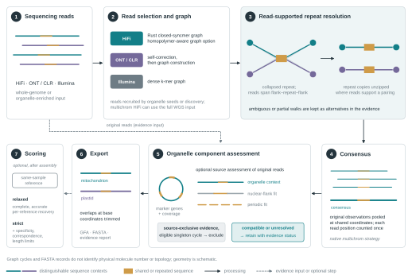
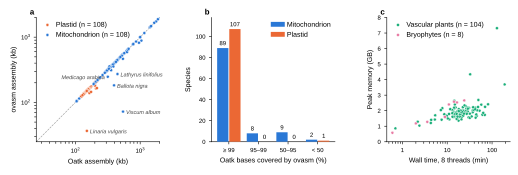

[English](README.md) | [简体中文](README.zh-CN.md)

<p align="center"></p>

# OVASM

OVASM assembles plant mitochondrial and plastid genomes from sequencing reads. Give it HiFi or
Illumina reads and it picks out the organelle reads, builds an assembly graph and writes the
sequences, the graph (GFA) and the reads that support each connection.

It is a single Rust program. It does not need conda, a container or other assemblers, and a typical
plant HiFi sample finishes in about 20 minutes on 8 threads with around 2 GB of memory.



## Install

Precompiled builds of 0.7.0 are on the [release page](https://github.com/forageseed/ovasm/releases/tag/v0.7.0).

- **Windows x86_64:** download the
  [ZIP](https://github.com/forageseed/ovasm/releases/download/v0.7.0/ovasm-v0.7.0-windows-x86_64.zip),
  extract it, double-click `install.cmd` and open a new terminal.
- **Linux x86_64 (glibc 2.34 or newer):**

```sh
curl -fsSL https://raw.githubusercontent.com/forageseed/ovasm/v0.7.0/scripts/install.sh | sh
export PATH="$HOME/.local/bin:$PATH"
ovasm --version
```

No internet on the machine? See [offline installation](docs/installation.md).

## Quick start

HiFi reads:

```sh
ovasm run hifi --reads sample.hifi.fastq.gz --organelle both --threads 8 --out result
```

Illumina paired reads:

```sh
ovasm run short --reads sample_R1.fq.gz --reads sample_R2.fq.gz --organelle both --threads 8 --out result
```

ONT reads, alone or with Illumina reads of the same sample ([details](docs/long-reads.md)). PacBio
CLR reads go through `run ont` too, but so far it has only been checked on ONT data.

```sh
ovasm run ont --reads sample.ont.fastq.gz --organelle both --threads 8 --out result
ovasm run hybrid --long sample.ont.fastq.gz --short sample_R1.fq.gz --short sample_R2.fq.gz --organelle both --threads 8 --out result
```

Each organelle gets its own folder in `result/` with:

- `molecules.fasta`: the assembled sequences;
- `organelle.gfa`: the assembly graph, including alternative connections that reads support;
- `evidence.json` and `assessment.json`: read support for every junction, depth, copy number,
  genes found and how complex the graph is.

Plant mitochondria often recombine across repeats, so one sample can carry several arrangements of
the same sequence. OVASM keeps those alternatives in the graph rather than picking one silently. A
circle in the graph is not proof of a single circular molecule.

### Commands

`ovasm run` does everything in one step. The individual steps are also available as
`ovasm <module> <command>`, and `-h` works at every level.

| Module | Commands | What it does |
|---|---|---|
| `run` | `short`, `hifi`, `ont`, `hybrid` | reads to sequences in one step |
| `find` | `recruit`, `discover`, `classify`, `label` | find the organelle reads |
| `assemble` | `correct`, `graph`, `filter`, `unify` | build the assembly graph |
| `check` | `evidence`, `unzip`, `assess` | check the graph against the reads |
| `solve` | `linearize`, `primary`, `chromosomes` | turn the graph into sequences |
| `pan` | `merge`, `reconstruct`, `identify`, `sharing` | work across many samples |

More: [rebuilding an individual from a species graph](docs/reference-reconstruction.md) ·
[all documentation](docs/).

## How well it works

### 112 Darwin Tree of Life species, against published Oatk assemblies

We ran `ovasm run hifi` with default settings on the HiFi reads of 112 species from the Darwin Tree
of Life project (104 vascular plants and 8 mosses) and compared the result with the Oatk assemblies
the Oatk authors published for the same species (Zenodo 15053552). For 108 species both assemblies
exist. The numbers are the share of the Oatk sequence that the OVASM assembly covers, using
minimap2 `asm5`.

| | Plastid | Mitochondrion |
|---|---:|---:|
| Species compared | 108 | 108 |
| OVASM covers ≥ 99% of the Oatk assembly | **107** | **89** |
| 95–99% | 0 | 8 |
| 50–95% | 0 | 9 |
| under 50% | 1 | 2 |
| Median share of Oatk covered | 99.99% | 99.98% |
| Median identity of the main alignments | 100% | 100% |

| Cost per species, 8 threads | Median | Largest |
|---|---:|---:|
| Wall time | 18.6 min | 190.6 min |
| Peak memory | 1.8 GB | 7.3 GB |



Where OVASM covers less than 95% of the Oatk mitochondrion (11 species), the problem is almost
always missing sequence rather than wrong sequence: in 9 of those 11, at least 99% of OVASM's own
assembly lies inside Oatk's. The clearest misses are the mitochondria of *Viscum album* (73 of
544 kb) and *Ballota nigra* (183 of 396 kb) and the plastid of *Linaria vulgaris* (37 of 151 kb).

Keep in mind:

- The Oatk assemblies are a point of comparison, not a gold standard; where the two differ, neither
  has been checked against an independent truth.
- These runs used build `78a265c` (0.6.0 plus `check assess`). The 0.7.0 recruitment fix for
  genomes whose read depth was misread (below) has not been rerun on this panel yet.
- The per-species table is in [`docs/figures/ovasm-vs-oatk-dtol.tsv`](docs/figures/ovasm-vs-oatk-dtol.tsv).

### Alfalfa ZM4, full HiFi data, against Oatk

Same 134 Gb of HiFi reads, 8 threads, on the same shared server:

| | Wall time | Peak memory |
|---|---:|---:|
| OVASM (`74e0cf7`) | 210 min | 2.0 GB |
| Oatk 1.0, including its annotation step | 942 min | 310 GB |

Both gave the same 125,509 bp plastid. OVASM's mitochondrion came out as 160,953 and 146,073 bp
sequences, with the 307,026 bp single-circle arrangement that Oatk reports kept as an alternative in
the graph. Details, graph figures and read support are in [benchmarks](docs/benchmarks.md).

### Illumina

Short reads are harder. On 20 existing alfalfa WGS samples an earlier build finished 14 runs; plastids
assembled well, but mitochondria usually came out in many pieces. Work on joining those pieces with
read pairs is ongoing. See the [WGS panel](docs/existing-wgs-benchmark.md).

## What's new in 0.7.0

- Recruiting reads is faster, with byte-identical output. An optional GPU path (`OVASM_GPU=1`) takes
  the Potentilla test sample from 13 to 10 minutes.
- Genomes whose read depth was misread no longer lose mitochondrial reads. *Lespedeza davurica*
  (allotetraploid) now gives its complete 378,667 bp mitochondrion without any extra options.
  `--genome-size` and `--nuclear-depth` let you set the depth by hand.

Full notes: [release 0.7.0](docs/release-0.7.0.md).

## License

MIT
