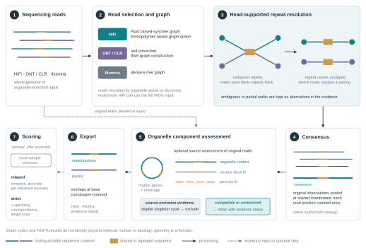
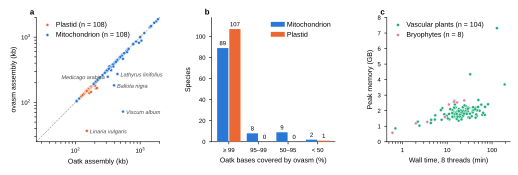

[English](README.md) | [简体中文](README.zh-CN.md)

<p align="center"></p>

# OVASM

**Evidence-stratified organelle genome assembly, base-modification profiling and species pan-genome reconstruction across eukaryotes.**

OVASM recruits organelle reads directly from unsorted whole-genome libraries, strips nuclear insertions (NUMTs/NUPTs) and inter-organellar transfers (MTPTs), builds a read-backed assembly graph, profiles `5mC`/`6mA` methylation from native modBAMs, and reconstructs population-scale organelle pan-genomes from short reads.

It ships as **one self-contained Rust executable** with zero external runtime dependencies—no Conda environment, Docker container, Python wrapper, external assembler or `htslib` required. A typical whole-genome HiFi dataset finishes in ~20 minutes on 8 threads in ~2 GB of RAM (median **18 seconds** on animal and fungal mitogenomes).



---

## Key Capabilities

- **Full-lineage eukaryotic assembly (`-x plant | animal | fungi`, or custom `--seeds`):**
  - **Land plants** (`-x plant` / `0`, default): simultaneous competitive recruitment and assembly of **mitochondria and plastids** (`-G all`) across bryophytes, ferns, gymnosperms and angiosperms, orienting circular plastomes into canonical `LSC-IRb-SSC-IRa` order and preserving multipartite circles and repeat-mediated alternative isomers in `organelle.gfa`.
  - **Animals** (`-x animal` / `1`): sponge-to-vertebrate mitogenomes (32 built-in RefSeq seeds + 551 core proteins under mitochondrial code 5, `TGA = Trp`, with automatic nuclear-component pruning).
  - **Fungi** (`-x fungi` / `2`): *Blastocladiomycota* to *Basidiomycota* mitogenomes (19 built-in RefSeq seeds + 696 core proteins under mold mitochondrial code 4, handling mobile-intron-expanded genomes >200 kb).
  - **Reference-free protein seeding (`-P`, default on HiFi WGS) & custom lineages (`-S`):** extracts conserved six-frame BLOSUM62 protein anchors from the sample's own reads under a reversed-sequence false-positive control, enabling assembly of divergent phyla without close nucleotide references; `--seeds` supports algae, protists or any custom organelle target.
- **Every major sequencing platform in one binary (`ovasm run`):**
  - **PacBio HiFi** (`run hifi`): FASTQ/FASTA or native `.bam`/`.ubam`, polyploid-aware depth gating, automatic sparse syncmer `k` ladder (`1001 → 101`), optional NVIDIA PTX replay acceleration (`OVASM_GPU=1`).
  - **ONT R10 Simplex, R9 & Hybrid** (`run ont`, `run hybrid`): built-in `hifiasm (--ont)`-style 4-stage phased overlap error corrector (`--chemistry auto|r10|legacy`, `--r10`: homopolymer-compressed minimizer overlaps, unbridged chimera clipping, directional strand-bias CpG/homopolymer pruning and four-gamete repeat phasing) plus EM homopolymer polishing and optional Illumina hybrid polishing.
  - **Illumina paired-end short reads** (`run short`): dense de Bruijn assembly with insert-size-calibrated paired-end gap closure across repeats.
- **Plant organelle methylation & epigenetic NUMT/NUPT separation (`check methylation`, `--methylation`):**
  - Pure-Rust parallel BGZF/BAM and SAMtags §1.7 `MM`/`ML` decoder calling per-site and per-segment **`CG`**, **`CHG`**, **`CHH`** 5mC and **`6mA`** directly from PacBio HiFi and ONT Dorado modBAMs.
  - Circular-wrap and symmetric repeat-preserving colinear 31-mer placement retains **100% of genomic CpG sites** across plastid inverted repeats (IRs) and large mitochondrial repeats where linear `MAPQ` aligners drop coverage; `--max-read-methylation` filters hypermethylated nuclear insertions prior to graph construction.
- **Species pan-organelle graphs & thousand-sample cohorts (`ovasm pan`):**
  - Lossless multi-sample OV-GFA merging (`pan merge` at `k = 63`, plus PGGB/minigraph import via `pan import` / `pan build`).
  - Evidence-stratified short-read individual reconstruction (`pan reconstruct`): multiallelic Empirical Bayes + exact maximum-weight matching + Poisson fragment-span junction falsification, emitting strict read-decided (`<organelle>.reads.fasta`) and panel-assisted (`<organelle>.fasta`) assemblies alongside diagnostic `genotypes.vcf`.
  - Cohort synthesis (`pan cohort`) across hundreds to thousands of WGS samples into `cohort.gfa` (with unbridged panel priors stripped), `presence.tsv`, `genotypes.vcf`, `junctions.tsv` and `nearest.tsv`.

---

## Install

Precompiled builds of **1.1.0** are on the [release page](https://github.com/forageseed/ovasm/releases/tag/v1.1.0).

- **Windows x86_64 (statically linked CRT):** download the
  [ZIP](https://github.com/forageseed/ovasm/releases/download/v1.1.0/ovasm-v1.1.0-windows-x86_64.zip),
  extract it, double-click `install.cmd` and open a new terminal.
- **Linux x86_64 (glibc 2.34 or newer):**

```sh
curl -fsSL https://raw.githubusercontent.com/forageseed/ovasm/v1.1.0/scripts/install.sh | sh
export PATH="$HOME/.local/bin:$PATH"
ovasm --version
```

No internet on the machine? See [offline installation](docs/installation.md).

---

## Quick Start

### 1. Cross-lineage HiFi assembly (plants, animals, fungi, algae/custom)

```sh
# Land plant: assemble both mitochondrion and plastid in one pass
ovasm run hifi -i sample.hifi.fastq.gz -G all -t 8 -o result

# Animal mitochondrion (-G mt is default; -x 0|1|2 aliases plant|animal|fungi as in PMAT2)
ovasm run hifi -i sample.hifi.fastq.gz -x animal -t 8 -o result_animal

# Fungal mitochondrion
ovasm run hifi -i sample.hifi.fastq.gz -x fungi -t 8 -o result_fungi

# Algae, protists or custom target using user-supplied seed FASTA
ovasm run hifi -i sample.hifi.fastq.gz -G all -S mt=algae_mt.fa -S pt=algae_pt.fa -t 8 -o result_algae
```

### 2. ONT R10 Simplex, R9, Hybrid & Illumina short reads

```sh
# ONT R10.4 Simplex or R9 (--chemistry auto selects phased overlap EC on R10 FASTQ)
ovasm run ont --reads sample.ont.fastq.gz --organelle both --threads 8 --out result_ont

# Hybrid ONT + Illumina paired-end reads
ovasm run hybrid --long sample.ont.fastq.gz --short sample_R1.fq.gz --short sample_R2.fq.gz --organelle both --threads 8 --out result_hybrid

# Illumina paired-end short reads
ovasm run short -i sample_R1.fq.gz sample_R2.fq.gz -G all -t 8 -o result_short
```

### 3. Organelle `5mC`/`6mA` methylation & epigenetic NUMT/NUPT filtering (PacBio / ONT modBAM)

```sh
# Assemble directly from HiFi or ONT Dorado modBAM, purging hypermethylated NUMT/NUPT reads
ovasm run hifi -i sample.hifi.mod.bam -G all --methylation --max-read-methylation 0.40 -t 16 -o result_meth
ovasm run ont --reads sample.ont.mod.bam --organelle both --methylation --max-read-methylation 0.40 --threads 16 --out result_ont_meth

# Standalone base-modification profiling on an existing FASTA or GFA
ovasm check methylation --target result/mitochondrion/molecules.fasta --gfa result/mitochondrion/organelle.gfa -b sample.mod.bam -t 16 -o meth_out
```

### 4. Species pan-organelle graph & population short-read cohort

```sh
# Prepare a 2-column TSV/TXT: sample<TAB>path (either run directory or organelle.gfa path)
#   ACC_001	assemblies/ACC_001
#   ACC_002	assemblies/ACC_002

# Batch-merge both organelles at once (writes pan/pan.mitochondrion.gfa & pan/pan.plastid.gfa)
ovasm pan merge -s panel_samples.tsv -G all -o pan
# Or merge a single organelle from run directories (-G mt / -G pt) or a direct GFA table:
ovasm pan merge -s mt_gfas.tsv -o pan/pan.mitochondrion.gfa

# Reconstruct an individual from Illumina WGS reads against both organelle pan-graphs
ovasm pan reconstruct --reads wgs_R1.fq.gz --reads wgs_R2.fq.gz \
  --reference mitochondrion=pan/pan.mitochondrion.gfa --reference plastid=pan/pan.plastid.gfa \
  --sample ACC_001 --threads 8 --out recon/ACC_001

# Summarize hundreds or thousands of reconstructed individuals (sample<TAB>recon_dir TSV)
ovasm pan cohort --samples cohort_samples.tsv --out cohort_out
```

### Output layout & agent-ready schema

Every `ovasm run` writes `result/result.json` (schema `ovasm.result.v1`; `--json` also prints it to stdout) reporting `status` (`complete`, `partial`, `no_molecule`, `failed`), molecule lengths and circularity, output paths, warnings, wall time and peak RSS. Under `-G all`, each organelle directory contains:

- `molecules.fasta`: assembled chromosomes/circles (plastids standardized to `LSC-IRb-SSC-IRa`);
- `organelle.gfa`: unified OV-GFA v1 assembly graph retaining read-supported alternative recombination paths (and `MC:f`/`MP:i`/`MD:f`/`MA:f` segment tags when `--methylation` is enabled);
- `evidence.json` and `assessment.json`: per-junction spanning read support, copy numbers, conserved gene inventory and graph complexity;
- `methylation.bed`, `reads.methylation.tsv` and `methylation.json` (when `--methylation` is enabled).

---

## Command Reference

`ovasm run` executes the full pipeline in one command; every stage is also callable individually via `ovasm <module> <command>` (`-h` for concise options, `--help` for all parameters):

| Module | Commands | Purpose |
|---|---|---|
| `run` | `hifi`, `ont`, `hybrid`, `short` | End-to-end assembly from raw reads or modBAMs |
| `find` | `recruit`, `discover`, `classify`, `label` | Depth-gated competitive recruitment and reference-free discovery |
| `assemble` | `correct`, `graph`, `filter`, `unify` | R10/R9 self-correction, syncmer/dBG construction and GFA unification |
| `check` | `evidence`, `unzip`, `assess`, `methylation` | Junction read verification, repeat unzipping, self-assessment and `5mC`/`6mA` profiling |
| `solve` | `linearize`, `primary`, `chromosomes` | Read-threaded path resolution and stoichiometry-aware chromosome calling |
| `pan` | `merge`, `import`, `build`, `reconstruct`, `cohort`, `identify`, `sharing` | Multi-sample pan-graphs, Empirical Bayes short-read reconstruction and cohort summaries |

Further details: [algorithm & thresholds](docs/method.md) · [ONT & hybrid assembly](docs/long-reads.md) · [species pan-graph reconstruction](docs/reference-reconstruction.md) · [all documentation](docs/).

---

## Benchmarks Across Kingdoms & Scales

### 1. 120 Darwin Tree of Life land plants (HiFi, vs published Oatk assemblies)

Across 120 DToL vascular plants and bryophytes with paired public Oatk assemblies (Zenodo 15053552), evaluated with origin-independent 10 kb sliding windows (5 kb step, `minimap2 -x asm5`) on 8 threads:

| Metric | Plastid | Mitochondrion |
|---|---:|---:|
| Species compared | 120 | 120 |
| OVASM covers ≥ 99% of Oatk | **118 / 120** | **109 / 120** (112 ≥ 95%) |
| ≥ 99% of OVASM lies within Oatk | **119 / 120** | **114 / 120** |
| Median coverage / alignment identity | **99.99% / 100%** | **99.98% / 100%** |
| Median wall time / peak memory (8 threads) | **21 min / 1.9 GB** | (max 3.2 h / 7.3 GB) |



Read-level arbitration on discordant loci showed zero nuclear-depth leakage and recovered **>120 kb of genuine read-backed mitochondrial sequence** omitted from public FASTAs (including *Schoenoplectus lacustris* +113 kb, *Buxus sempervirens* +22.5 kb subcircle, *Fallopia convolvulus* +6.6 kb and *Triglochin maritima* +6.6 kb).

### 2. Deep plant libraries & curated *Oryza* gold standard

| Dataset & Platform | OVASM | Comparison |
|---|---|---|
| **Alfalfa ZM4** (`134 Gb` HiFi, 8 threads) | **210 min · 1.98 GiB** (exact 125,509 bp plastid + 160,953 & 146,073 bp mt circles + 307,026 bp graph alternative) | Oatk 1.0: **942 min · 310.4 GiB** (`155×` higher peak RAM) |
| **Alfalfa ZM4** (`38 Gb` ONT, 8 threads) | **52 min · 3.4 GiB** (plastid + both mt circles, 99.993% identity) | — |
| **Rice Nipponbare** curated `NIP_mt.gfa` (HiFi) | **61 min · 2.61 GiB**, **16/16** strict junctions, **8/8** branch nodes, **99.999%** coverage + 5 read-backed substoichiometric branches (+15,744 bp) | Oatk: **46.12 GiB** (10/16 strict junctions); PMAT2: failed at 10 h / 60 GB |
| **Plant modBAM NUMT rescue** (HiFi & ONT R10.4.1) | **100%** repeat/IR CpG retention; `--max-read-methylation` rescues *Astragalus alpinus* (HiFi, `287.4 kb → 313,827 bp` circle) & *Medicago arabica* (ONT R10 Dorado modBAM, `247.2 kb → 334,332 bp` circle, 33/33 genes) | Linear `MAPQ` filters lose 32–81% of repeat CpGs |

### 3. 80 animal & fungal species without nucleotide seed libraries (PMAT2 multi-kingdom benchmark)

Evaluated on the 80 NCBI-referenced HiFi libraries (57 Metazoa, 23 Fungi) from the PMAT2 benchmark using default six-frame BLOSUM62 self-seeding:

| Assembler | Complete (≥ 95% cov) | Metazoa (n = 57) | Fungi (n = 23) | Perfect single-contig | Median time / sample |
|---|---:|---:|---:|---:|---:|
| **OVASM** | **63 / 80** | **45 / 57** | **18 / 23** | **59 / 80** | **18 s** |
| PMAT2 | 56 / 80 | 42 / 57 | 14 / 23 | 51 / 80 | 2,710 s (`151×` slower) |
| HiMT | 56 / 80 | 44 / 57 | 12 / 23 | 45 / 80 | 289 s (`16×` slower) |

### 4. Species pan-graph + Illumina short-read reconstruction (leave-one-out validation)

- ***Arabidopsis thaliana* (`n = 48` HiFi panel, Illumina WGS reconstruction):** median strict mitochondrial `v2` recall **99.91%** (47/48 ≥ 99%, median **3** molecules, **11.9 min / 6.42 GB**) vs GetOrganelle **6.59%** (2.4 h / 18.45 GB); anchor misjoins drop from **40.7%** (de novo short-read) to **1.3%** (panel layer) and **0.7%** (reads layer). Plastid median recall: **100.00%** (1 molecule). `pan cohort` merges 47 samples into `cohort.gfa` + VCF in **9.96 s / 128 MB**.
- ***Oryza sativa / O. rufipogon* (`n = 6` leave-one-out):** median strict mitochondrial `v2` recall **98.26%** (`v1` coverage **99.65%**, 6.33 GB), whereas GetOrganelle failed on 4/6 samples (>60 GB RAM or 6 h timeout).

---

## Release History

- **[1.1.0](docs/release-1.1.0.md)** — Plant organelle `5mC`/`6mA` methylation & epigenetic NUMT/NUPT separation (`check methylation`, `run hifi`/`run ont` modBAMs), native ONT R10 Simplex phased overlap error correction, canonical `LSC-IRb-SSC-IRa` plastid layout and cohort/low-depth fixes.
- **[1.0.0](docs/release-1.0.0.md)** — Species pan-graph reconstruction v4 (`pan reconstruct` two-layer output) and thousand-sample `pan cohort` engine.
- **[0.9.0](docs/release-0.9.0.md)** — Paired-end short-read gap closure, EM homopolymer polishing and traversal self-assessment.
- **[0.8.0](docs/release-0.8.0.md)** — Self-seeded cross-kingdom recruitment (`-x plant|animal|fungi`), audited seed provenance and `ovasm.result.v1`.
- **[0.7.0](docs/release-0.7.0.md)** — Accelerated 2-bit/GPU recruitment, polyploid depth gating, `run ont` and `run hybrid`.

## Author & License

Developed by **zhicheng jia**. Released under the [MIT License](LICENSE).
