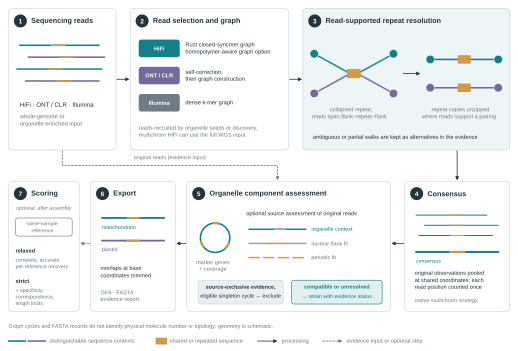
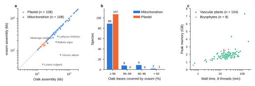

[English](README.md) | [简体中文](README.zh-CN.md)

<p align="center"></p>

# OVASM

**跨真核生物全谱系的证据分层细胞器基因组组装、碱基甲基化分析与物种泛基因组重建引擎。**

OVASM 直接从未经分选的全基因组测序文库中招募细胞器读段，剥离核内细胞器插入片段（NUMT/NUPT）与跨细胞器转移片段（MTPT），构建有读段证据支撑的组装图，直接从原生 `modBAM` 解析 `5mC`/`6mA` 甲基化图谱，并基于物种泛图与二代短读段完成千样本规模的群体细胞器重建。

它是一个**零外部运行时依赖的纯 Rust 单一可执行文件**——无需 Conda 环境、Docker 容器、Python 包装脚本、第三方组装器或 `htslib`。常规陆生植物全基因组 HiFi 样本在 8 线程下约 **20 分钟、2 GB 内存**即可完成（动物与真菌线粒体中位耗时仅 **18 秒**）。



---

## 核心功能亮点

- **真核全谱系细胞器组装（`-x plant | animal | fungi`，或自定义 `--seeds`）：**
  - **陆生植物**（`-x plant` / `0`，默认）：覆盖苔藓、蕨类、裸子植物与被子植物，一次扫描竞争性同步招募并组装**线粒体与叶绿体**（`-G all`），自动将环状叶绿体规范为标准 `LSC-IRb-SSC-IRa` 四分体定向，并在 `organelle.gfa` 中无偏保留多环亚基因组与重复介导的替代重组构象。
  - **后生动物**（`-x animal` / `1`）：覆盖海绵至脊椎动物线粒体（内置 32 个代表性 RefSeq 线粒体种子 + 551 个核心蛋白面板，采用无脊椎动物线粒体遗传密码表 5，`TGA = Trp`，自动剪除无基因核背景连通分量）。
  - **真菌**（`-x fungi` / `2`）：覆盖芽枝霉门至担子菌门线粒体（内置 19 个 RefSeq 种子 + 696 个核心蛋白面板，采用霉菌线粒体遗传密码表 4，适配移动内含子扩张的 >200 kb 大型真菌线粒体）。
  - **无参考核酸依赖的自提取蛋白播种（`-P`，HiFi 全基因组默认启用）与藻类/原生生物扩展（`-S`）：** 直接从样本自身读段开展六框 BLOSUM62 蛋白锚点提取（含反转序列假阳性对照），远缘门类无需近缘核酸参考即可启动招募；同时支持通过 `--seeds` 传入藻类、原生生物或任意自定义细胞器种子。
- **全测序平台统一覆盖（`ovasm run`）：**
  - **PacBio HiFi**（`run hifi`）：支持 FASTQ/FASTA 及原生 `.bam`/`.ubam`，具备多倍体感知的核深度门控、稀疏 syncmer 自动 `k` 阶梯（`1001 → 101`）以及可选 NVIDIA PTX 回放加速（`OVASM_GPU=1`）。
  - **ONT R10 Simplex、R9 与长短混合组装**（`run ont`、`run hybrid`）：内置 `hifiasm (--ont)` 风格四阶段相位重叠自纠错（`--chemistry auto|r10|legacy`、`--r10`：同聚物压缩最小子重叠、未桥接嵌合体裁剪、链偏倚甲基化/同聚物假多态剔除与四配子动态规划重复分相）与 EM 同聚物抛光，并支持结合 Illumina 短读段混合纠错。
  - **Illumina 双端短读段**（`run short`）：稠密 de Bruijn 构图结合文库插入片段跨度校准的双端缺口闭合。
- **植物细胞器甲基化与表观 NUMT/NUPT 分离（`check methylation`、`--methylation`）：**
  - 纯 Rust 并行解码 BGZF/BAM 与 SAMtags §1.7 `MM`/`ML` 标签，直接从 PacBio HiFi 与 ONT Dorado `modBAM` 统计逐位点及逐图片段的 **`CG`**、**`CHG`**、**`CHH`** 5mC 与 **`6mA`** 修饰水平。
  - 环状跨界回绕与对称保重复 31-mer 共线定位在叶绿体反向重复区（IR）与线粒体大重复区**完整保留 100% 基因组 CpG 位点**（避免线性比对 `MAPQ` 过滤导致的大段盲区）；`--max-read-methylation` 可在构图前精准剔除高甲基化核插入读段。
- **物种泛细胞器图谱与千样本群体队列（`ovasm pan`）：**
  - 多品系组装图无损合并（`pan merge`，`k = 63` 保留全部样本构象路径与 `uj:Z:` 溯源；`pan import` / `pan build` 兼容 PGGB 与 minigraph）。
  - 证据分层短读段个体重建（`pan reconstruct`）：多等位基因经验贝叶斯后验 + 精确最大权完美匹配 + 泊松片段跨度连接证伪，严格分流输出仅由读段决定的 `<organelle>.reads.fasta` 与面板辅助的 `<organelle>.fasta`（及诊断性 `genotypes.vcf`）。
  - 大规模群体整合（`pan cohort`）：秒级汇总数百至上千个样本，切断未获读段跨越的先验边，导出 `cohort.gfa`、`presence.tsv`、`genotypes.vcf`、`junctions.tsv` 与 `nearest.tsv`。

---

## 安装

**1.1.0** 双平台预编译包位于 [GitHub Releases](https://github.com/forageseed/ovasm/releases/tag/v1.1.0)。

- **Windows x86_64（静态链接 CRT，免装运行库）：** 下载
  [ZIP 包](https://github.com/forageseed/ovasm/releases/download/v1.1.0/ovasm-v1.1.0-windows-x86_64.zip)，
  解压后双击 `install.cmd`，重新打开终端即可使用。
- **Linux x86_64（glibc 2.34 及以上）：**

```sh
curl -fsSL https://raw.githubusercontent.com/forageseed/ovasm/v1.1.0/scripts/install.sh | sh
export PATH="$HOME/.local/bin:$PATH"
ovasm --version
```

无外网服务器或源码编译请参见[离线安装指南](docs/installation.md)。

---

## 快速开始

### 1. 跨界全谱系 HiFi 组装（植物、动物、真菌、藻类/自定义种子）

```sh
# 陆生植物：一次招募同步组装线粒体与叶绿体
ovasm run hifi -i sample.hifi.fastq.gz -G all -t 8 -o result

# 动物线粒体（默认 -G mt；-x 0|1|2 与 PMAT2 一致，分别对应 plant|animal|fungi）
ovasm run hifi -i sample.hifi.fastq.gz -x animal -t 8 -o result_animal

# 真菌线粒体
ovasm run hifi -i sample.hifi.fastq.gz -x fungi -t 8 -o result_fungi

# 藻类、原生生物或自定义目标（传入自定义种子 FASTA）
ovasm run hifi -i sample.hifi.fastq.gz -G all -S mt=algae_mt.fa -S pt=algae_pt.fa -t 8 -o result_algae
```

### 2. ONT R10 Simplex / R9、长短混合与 Illumina 短读段组装

```sh
# ONT R10.4 Simplex 或 R9 单独组装（--chemistry auto 对校准 R10 FASTQ 自动启用相位重叠纠错）
ovasm run ont --reads sample.ont.fastq.gz --organelle both --threads 8 --out result_ont

# ONT 长读段 + 同样本 Illumina 双端短读段混合组装
ovasm run hybrid --long sample.ont.fastq.gz --short sample_R1.fq.gz --short sample_R2.fq.gz --organelle both --threads 8 --out result_hybrid

# Illumina 双端短读段从头组装
ovasm run short -i sample_R1.fq.gz sample_R2.fq.gz -G all -t 8 -o result_short
```

### 3. 细胞器 `5mC`/`6mA` 甲基化分析与表观剔除 NUMT/NUPT（PacBio / ONT modBAM）

```sh
# 直接从 HiFi 或 ONT Dorado modBAM 组装并过滤高甲基化核插入读段
ovasm run hifi -i sample.hifi.mod.bam -G all --methylation --max-read-methylation 0.40 -t 16 -o result_meth
ovasm run ont --reads sample.ont.mod.bam --organelle both --methylation --max-read-methylation 0.40 --threads 16 --out result_ont_meth

# 对已有组装序列和 GFA 单独运行甲基化位点与图片段注释
ovasm check methylation --target result/mitochondrion/molecules.fasta --gfa result/mitochondrion/organelle.gfa -b sample.mod.bam -t 16 -o meth_out
```

### 4. 物种泛细胞器图谱构建与千样本短读段群体重建

```sh
# 准备两列 TSV 或 TXT（一列样本名，一列组装目录或 organelle.gfa 路径）：
#   ACC_001	assemblies/ACC_001
#   ACC_002	assemblies/ACC_002

# 一条命令同时合并线粒体与叶绿体泛图（输出 pan/pan.mitochondrion.gfa 与 pan/pan.plastid.gfa）
ovasm pan merge -s panel_samples.tsv -G all -o pan
# 也可按单个细胞器合并（目录加 -G mt / -G pt，或直接给 GFA 文件路径表）：
ovasm pan merge -s mt_gfas.tsv -o pan/pan.mitochondrion.gfa

# 基于物种泛图从单个样本的 Illumina WGS 短读段重建双细胞器
ovasm pan reconstruct --reads wgs_R1.fq.gz --reads wgs_R2.fq.gz \
  --reference mitochondrion=pan/pan.mitochondrion.gfa --reference plastid=pan/pan.plastid.gfa \
  --sample ACC_001 --threads 8 --out recon/ACC_001

# 批量汇总成百上千个重建样本（sample<TAB>recon_dir 表），输出群体泛图、PAV 表、VCF 与重组连接频率
ovasm pan cohort --samples cohort_samples.tsv --out cohort_out
```

### 输出目录结构

每次 `ovasm run` 均输出固定结构的 `result/result.json`（`ovasm.result.v1`，加 `--json` 可同步输出到标准输出），记录运行状态（`complete`、`partial`、`no_molecule`、`failed`）、分子长度与环状标记、文件路径、耗时与峰值内存。`-G all` 下每个细胞器子目录包含：

- `molecules.fasta`：组装序列（环状叶绿体自动规范为 `LSC-IRb-SSC-IRa`）；
- `organelle.gfa`：统一 OV-GFA v1 组装图，保留读段支持的替代重组连接（启用 `--methylation` 时附带片段级甲基化标签）；
- `evidence.json` 与 `assessment.json`：每处连接的跨接读段支持、深度、拷贝数一致性、保守基因检出与图复杂度；
- `methylation.bed`、`reads.methylation.tsv` 与 `methylation.json`（启用 `--methylation` 时生成）。

---

## 命令模块总览

`ovasm run` 一步跑完全流程；各阶段也可通过 `ovasm <模块> <子命令>` 独立调用（`-h` 查看常用参数，`--help` 查看全部参数）：

| 模块 | 子命令 | 功能说明 |
|---|---|---|
| `run` | `hifi`、`ont`、`hybrid`、`short` | 从原始读段或 modBAM 一步完成招募、组装、校验与评估 |
| `find` | `recruit`、`discover`、`classify`、`label` | 深度门控竞争性招募与无种子深度簇细胞器识别 |
| `assemble` | `correct`、`graph`、`filter`、`unify` | R10/R9 长读段自纠错、syncmer/dBG 构图与 GFA 统一 |
| `check` | `evidence`、`unzip`、`assess`、`methylation` | 连接读段核验、重复解链、自评估与 `5mC`/`6mA` 修饰分析 |
| `solve` | `linearize`、`primary`、`chromosomes` | 读段穿引路径求解与化学计量感知的多染色体/异构体判定 |
| `pan` | `merge`、`import`、`build`、`reconstruct`、`cohort`、`identify`、`sharing` | 物种泛图构建、经验贝叶斯短读段重建与大规模群体汇总 |

延伸阅读：[算法与阈值说明](docs/method.md) · [ONT 与混合组装](docs/long-reads.md) · [物种泛图个体重建](docs/reference-reconstruction.md) · [完整评测记录](docs/benchmarks.zh-CN.md) · [全部文档](docs/)。

---

## 跨界与多尺度基准表现

### 1. 120 种达尔文生命之树（DToL）陆生植物（HiFi，对照公开 Oatk 组装）

在具备配对公开 Oatk 组装（Zenodo 15053552）的 120 种维管植物与苔藓上，采用不受环起点影响的 10 kb 滑窗（步长 5 kb，`minimap2 -x asm5`，8 线程）评估：

| 指标 | 叶绿体 | 线粒体 |
|---|---:|---:|
| 参比物种数 | 120 | 120 |
| OVASM 覆盖 Oatk ≥ 99% | **118 / 120** | **109 / 120**（≥ 95% 达 112） |
| OVASM 自身序列落入 Oatk ≥ 99% | **119 / 120** | **114 / 120** |
| 覆盖比例 / 主比对一致性中位数 | **99.99% / 100%** | **99.98% / 100%** |
| 单物种中位耗时 / 峰值内存（8 线程） | **21 分钟 / 1.9 GB** | （最大 3.2 小时 / 7.3 GB） |



对分歧区间的原始读段仲裁显示无一例落入核覆盖深度，并找回公开 FASTA 遗漏的 **>120 kb 真实读段支持线粒体序列**（含水葱 *Schoenoplectus lacustris* +113 kb、黄杨 *Buxus sempervirens* +22.5 kb 独立小环、卷茎蓼 *Fallopia convolvulus* +6.6 kb 与海韭菜 *Triglochin maritima* +6.6 kb）。

### 2. 超深植物测序、日本晴金标准与表观 NUMT 分离

| 数据集与平台 | OVASM 表现 | 对照结果 |
|---|---|---|
| **紫花苜蓿 ZM4**（`134 Gb` HiFi，8 线程） | **210 分钟 · 1.98 GiB**（精确 125,509 bp 叶绿体环 + 160,953 / 146,073 bp 双线粒体环，图中保留 307,026 bp 单环异构体） | Oatk 1.0：**942 分钟 · 310.4 GiB**（峰值内存高 155 倍） |
| **紫花苜蓿 ZM4**（`38 Gb` ONT，8 线程） | **52 分钟 · 3.4 GiB**（叶绿体 + 双线粒体环，一致性 99.993%） | — |
| **水稻日本晴精校图谱** `NIP_mt.gfa`（HiFi） | **61 分钟 · 2.61 GiB**，**16/16** 严格连接、**8/8** 分枝节点全恢复（覆盖度 **99.999%**），并检出 5 条真实亚化学计量分枝（+15,744 bp） | Oatk：**46.12 GiB**（严格连接 10/16）；PMAT2 运行 10 小时 / 60 GB 报错退出 |
| **植物 modBAM 甲基化去核污染**（HiFi & ONT R10.4.1） | 大重复与 IR 区 **100% 保留基因组 CpG 位点**；`--max-read-methylation` 将高山黄耆（HiFi）线粒体由 `287.4 kb` 恢复为完整环 **`313,827 bp`**，将阿拉伯苜蓿（ONT R10 Dorado modBAM）由 `247.2 kb` 恢复为完整环 **`334,332 bp`（33/33 基因）** | 常规线性比对 `MAPQ` 过滤丢失重复区 32%–81% 的 CpG 位点 |

### 3. 80 种动物与真菌跨界基准（无核酸种子库，PMAT2 多界别数据集）

在 PMAT2 基准论文具备 NCBI 参考序列的 80 个物种（57 种后生动物、23 种真菌）HiFi 文库上，仅凭默认六框蛋白自播种运行：

| 工具 | 完整组装（覆盖 ≥ 95%） | 后生动物（n = 57） | 真菌（n = 23） | 单连续完美组装 | 单样本中位耗时 |
|---|---:|---:|---:|---:|---:|
| **OVASM** | **63 / 80** | **45 / 57** | **18 / 23** | **59 / 80** | **18 秒** |
| PMAT2 | 56 / 80 | 42 / 57 | 14 / 23 | 51 / 80 | 2,710 秒（慢 151 倍） |
| HiMT | 56 / 80 | 44 / 57 | 12 / 23 | 45 / 80 | 289 秒（慢 16 倍） |

### 4. 物种泛图 + Illumina 短读段群体重建（留一法交叉验证）

- **拟南芥（`n = 48` HiFi 面板，Illumina WGS 短读段留一法重建）：** 线粒体严格 `v2` 召回率中位数达 **99.91%**（47/48 ≥ 99%，中位 **3** 条分子，耗时 **11.9 分钟 / 6.42 GB**），显著优于 GetOrganelle 的 **6.59%**（2.4 小时 / 18.45 GB）；锚定端错连率由纯从头短读段组装的 **40.7%** 降至面板层 **1.3%**、读段层 **0.7%**。叶绿体中位召回率 **100.00%**（单分子）。`pan cohort` 在 **9.96 秒 / 128 MB** 内完成 47 个样本的群体图与 VCF 合成。
- **稻属栽培稻与野生稻（`n = 6` 留一法重建）：** 线粒体严格 `v2` 召回率中位数 **98.26%**（`v1` 覆盖度 **99.65%**，6.33 GB），而 GetOrganelle 在 4/6 份样本上因突破 60 GB 内存或 6 小时超时失败。

---

## 版本历史

- **[1.1.0](docs/release-1.1.0.md)** — 植物细胞器 `5mC`/`6mA` 甲基化分析与表观 NUMT/NUPT 分离（`check methylation` 及 `run hifi`/`run ont` modBAM 支持）、原生 ONT R10 Simplex 相位重叠自纠错、叶绿体标准 `LSC-IRb-SSC-IRa` 定向及群体/浅深度修复。
- **[1.0.0](docs/release-1.0.0.md)** — 物种泛图重建 v4（`pan reconstruct` 双层证据输出）与千样本群体汇总引擎（`pan cohort`）。
- **[0.9.0](docs/release-0.9.0.md)** — 双端短读段缺口闭合、EM 同聚物抛光与组装遍历自检。
- **[0.8.0](docs/release-0.8.0.md)** — 植物/动物/真菌跨界蛋白自播种招募、种子溯源核验与 `ovasm.result.v1`。
- **[0.7.0](docs/release-0.7.0.md)** — 2-bit/GPU 招募加速、多倍体核深度门控、`run ont` 与 `run hybrid`。

## 作者与许可

作者：**zhicheng jia**。基于 [MIT License](LICENSE) 开源发布。
