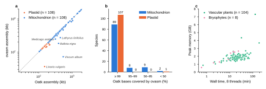

[English](README.md) | [简体中文](README.zh-CN.md)

<p align="center"></p>

# OVASM

OVASM 用测序读段组装植物线粒体和叶绿体基因组。输入 HiFi 或 Illumina 读段，它会挑出细胞器读段、构建组装图，
输出序列、组装图（GFA），以及支持每处连接的读段。

它是一个独立的 Rust 程序，不需要 conda、容器或其他组装软件。一个典型的植物 HiFi 样本用 8 线程大约 20 分钟跑完，
内存 2 GB 左右。


## 安装

0.7.0 预编译版在[下载页](https://github.com/forageseed/ovasm/releases/tag/v0.7.0)。

- **Windows x86_64：**下载
  [ZIP](https://github.com/forageseed/ovasm/releases/download/v0.7.0/ovasm-v0.7.0-windows-x86_64.zip)，
  解压后双击 `install.cmd`，然后重新打开终端。
- **Linux x86_64（glibc 2.34 及以上）：**

```sh
curl -fsSL https://raw.githubusercontent.com/forageseed/ovasm/v0.7.0/scripts/install.sh | sh
export PATH="$HOME/.local/bin:$PATH"
ovasm --version
```

机器不能联网的话，看[离线安装](docs/installation.md)。

## 快速开始

HiFi 读段：

```sh
ovasm run hifi --reads sample.hifi.fastq.gz --organelle both --threads 8 --out result
```

Illumina 双端读段：

```sh
ovasm run short --reads sample_R1.fq.gz --reads sample_R2.fq.gz --organelle both --threads 8 --out result
```

`result/` 下每个细胞器一个文件夹，里面有：

- `molecules.fasta`：组装出的序列；
- `organelle.gfa`：组装图，包括有读段支持的替代连接；
- `evidence.json` 和 `assessment.json`：每处连接的读段支持、深度、拷贝数、找到的基因，以及组装图有多复杂。

植物线粒体常在重复序列之间重组，同一个样本里可能同时存在同一段序列的几种排列。OVASM 把这些替代连接留在图里，
不会悄悄只挑一种。图上有一个环，并不能证明细胞里就是一条环状分子。

### 命令

`ovasm run` 一步跑完全部流程；每一步也可以单独用 `ovasm <模块> <命令>` 运行，每一层都支持 `-h`。

| 模块 | 命令 | 作用 |
|---|---|---|
| `run` | `short`、`hifi` | 从读段一步到序列 |
| `find` | `recruit`、`discover`、`classify`、`label` | 找出细胞器读段 |
| `assemble` | `correct`、`graph`、`filter`、`unify` | 构建组装图 |
| `check` | `evidence`、`unzip`、`assess` | 用读段核对组装图 |
| `solve` | `linearize`、`primary`、`chromosomes` | 把组装图理成序列 |
| `pan` | `merge`、`reconstruct`、`identify`、`sharing` | 多样本分析 |

更多：[用种内参考图重建个体](docs/reference-reconstruction.md) · [全部文档](docs/)。

## 效果

### 112 个生命之树（DToL）物种，对照已发表的 Oatk 组装

我们用默认参数对 Darwin Tree of Life 项目 112 个物种（104 个维管植物、8 个藓类）的 HiFi 读段跑了
`ovasm run hifi`，再和 Oatk 作者为同一批物种公开的 Oatk 组装（Zenodo 15053552）比较。两边都有组装的物种有 108 个。
下表的数字是 OVASM 组装覆盖了 Oatk 序列的多少，用 minimap2 `asm5` 比对。

| | 叶绿体 | 线粒体 |
|---|---:|---:|
| 比较的物种 | 108 | 108 |
| OVASM 覆盖 Oatk 组装 ≥ 99% | **107** | **89** |
| 95–99% | 0 | 8 |
| 50–95% | 0 | 9 |
| 不到 50% | 1 | 2 |
| 覆盖比例中位数 | 99.99% | 99.98% |
| 主比对一致性中位数 | 100% | 100% |

| 每个物种的开销（8 线程） | 中位数 | 最大 |
|---|---:|---:|
| 耗时 | 18.6 分钟 | 190.6 分钟 |
| 峰值内存 | 1.8 GB | 7.3 GB |



OVASM 覆盖不到 Oatk 线粒体 95% 的有 11 个物种，问题基本都是少了序列，而不是序列拼错：其中 9 个物种，
OVASM 自己的组装至少 99% 都落在 Oatk 组装里。差得最多的是 *Viscum album*（槲寄生）线粒体（544 kb 里只有 73 kb）、
*Ballota nigra* 线粒体（396 kb 里 183 kb）和 *Linaria vulgaris* 叶绿体（151 kb 里 37 kb）。

需要注意：

- Oatk 组装只是对照，不是标准答案；两者不一致的地方，都还没有用独立的真值核对过。
- 这批结果用的是 `78a265c` 构建（0.6.0 加上 `check assess`）。0.7.0 修复了读段深度误判导致的漏招（见下），
  还没在这批物种上重跑。
- 逐物种结果见 [`docs/figures/ovasm-vs-oatk-dtol.tsv`](docs/figures/ovasm-vs-oatk-dtol.tsv)。

### 苜蓿 ZM4 全量 HiFi，对照 Oatk

同样 134 Gb HiFi 读段、8 线程、同一台共享服务器：

| | 耗时 | 峰值内存 |
|---|---:|---:|
| OVASM（`74e0cf7`） | 210 分钟 | 2.0 GB |
| Oatk 1.0（含注释步骤） | 942 分钟 | 310 GB |

两者给出的叶绿体相同，都是 125,509 bp。OVASM 的线粒体输出为 160,953 bp 和 146,073 bp 两条序列，
Oatk 报告的 307,026 bp 单环排列作为替代连接保留在图里。细节、组装图对比和读段支持见[测试记录](docs/benchmarks.zh-CN.md)。

### Illumina

短读长更难。早先的版本在 20 个已有苜蓿 WGS 样本上跑完了 14 个：叶绿体组装得不错，线粒体通常碎成很多段。
用双端读段把这些片段连起来的工作还在进行。见 [WGS 批测](docs/existing-wgs-benchmark.md)。

## 0.7.0 更新

- 招募读段更快，输出逐字节不变。可选的 GPU 路径（`OVASM_GPU=1`）让 Potentilla 测试样本从 13 分钟降到 10 分钟。
- 读段深度被误判的基因组不再漏招线粒体读段。异源四倍体胡枝子（*Lespedeza davurica*）不加任何参数就能得到
  完整的 378,667 bp 线粒体。也可以用 `--genome-size` 或 `--nuclear-depth` 手动给出深度。

完整说明：[0.7.0 发布说明](docs/release-0.7.0.md)。

## 许可

MIT
