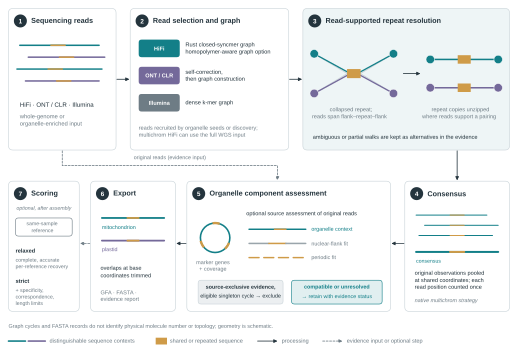

[English](README.md) | [简体中文](README.zh-CN.md)

<p align="center"></p>

# OVASM

**Rust 细胞器组装：读段 → 线粒体、叶绿体序列、GFA 和读段证据。**

OVASM 招募细胞器读段、构建组装图，并保留有读段支持的替代连接。支持 HiFi 和 Illumina；可使用种内参考图辅助二代个体重建。



## 安装

**0.3.0 预编译版，无需编译。**

- **Windows x86_64：**[下载 ZIP](https://github.com/forageseed/ovasm/releases/download/v0.3.0/ovasm-v0.3.0-windows-x86_64.zip)，解压后双击 `install.cmd`，重开终端。
- **Linux x86_64，glibc 2.34+：**

```sh
curl -fsSL https://raw.githubusercontent.com/forageseed/ovasm/v0.3.0/scripts/install.sh | sh
export PATH="$HOME/.local/bin:$PATH"
ovasm --version
```

[下载页](https://github.com/forageseed/ovasm/releases/tag/v0.3.0) · [离线安装](docs/installation.md)

## 使用

```sh
ovasm run --reads sample.hifi.fastq.gz --organelle both --threads 8 --out result
```

Illumina 数据添加 `--read-type sr`。结果包含代表序列、GFA、连接支持和来源候选。结构有歧义时保留分支；图上的环不能直接当作物理染色体。

[种内参考图 → 二代个体重建](docs/reference-reconstruction.md) · [详细用法](https://github.com/forageseed/ovasm/tree/main/docs)

## 测试结果

| ZM4 完整 HiFi，同为 8 线程 | 总耗时 | 采样进程组 RSS 峰值 |
|---|---:|---:|
| OVASM | 210.20 分钟 | 1.983 GiB |
| OATK，包含注释 | 942.35 分钟 | 310.416 GiB |

OVASM 输出线粒体代表序列 160,953 和 146,073 bp，叶绿体代表序列 125,509 bp。代表序列条数不等于已认证的物理染色体数。表中是已有完整输入基准记录，不是 0.3.0 的新测速。

20 个 WGS 首轮任务中，14 个命令执行完成，6 个达到资源限制；命令完成不代表线粒体完整组装。

[完整测试记录](docs/benchmarks.zh-CN.md) · [WGS 批测](docs/existing-wgs-benchmark.md) · [GFA／ONT 证据](docs/hifi-configuration-comparison.md) · [Rust HPC 验证](docs/rust-kernel.md)

## 贡献者与许可

Codex（OpenAI）：代码实现、测试、科研图与文档。**MIT**。
