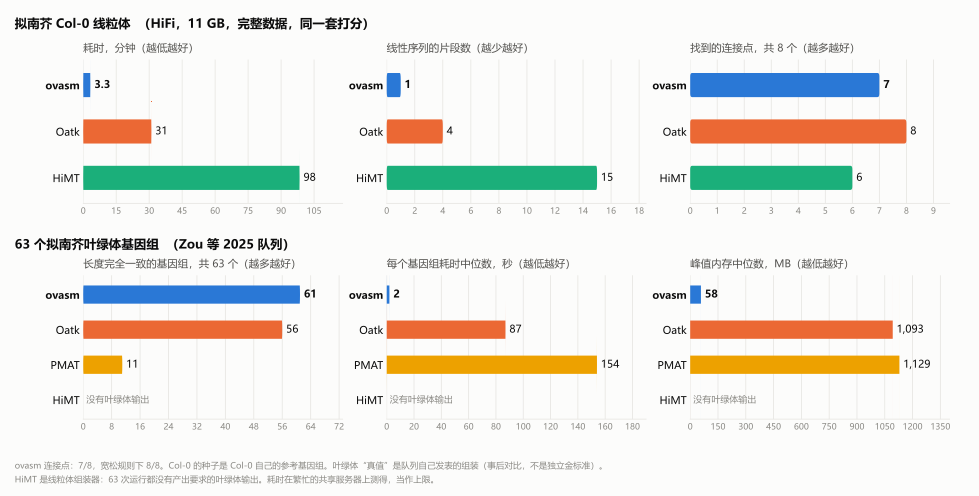

[English](README.md) | [简体中文](README.zh-CN.md)

<p align="center"></p>

# ovasm

**从全基因组测序数据组装植物线粒体和叶绿体基因组——拿到的是图、代表分子，以及每个连接背后的读段证据。**

ovasm 是一个 Rust 程序：给它 HiFi、ONT、CLR 或 Illumina 全基因组 reads，它会招募细胞器读段、构建组装图、统计每条连接、分支和重复的支持读段数，再展开代表分子。植物线粒体通常同时存在多种构型；reads 分不清结构时，ovasm 会如实写 `decisive: false`，不会悄悄猜一个。

- **不需要参考序列。** 内置 16 个线粒体、44 个叶绿体陆地植物基因组组成的种子库负责招募读段；可用 `--seeds` 换成更近缘的参考，也可用 `--recruit discover` 完全免种子（按 k-mer 深度，HiFi）。
- **证据，而不只是序列。** 每个连接的支持读段数都写进 `evidence.json`；`--mode standard` 加做降采样重复，报告每个连接的复现率。
- **又快又省。** 拟南芥 Col-0 全量 HiFi 约 3 分钟、峰值 229 MB；同期实测的其他工具需要 31–98 分钟、0.3–1.1 GB 内存（[对比与限制](#和现有工具比较)）。单个二进制，在 Linux 和 Windows 上构建并测试。
- **泛基因组就绪。** 图同时导出为 OV-GFA；`ovasm pan` 把多个样本合并为一张泛基因组图；`ovasm reconstruct` 用短读段从物种参考图重建个体的细胞器基因组。
- **一个程序，每个阶段都是命令。** `ovasm run` 串起招募、组装、证据、线性化和导出；每个阶段也都能单独调用。
- **如实报告。** 盲测轮次（包括失败）和每项基准的限制都在下文公开；`k_accepted` 和 `decisive` 就是留着让你核对的，不是让你盲信的。

[OrganelleVerse](https://github.com/forageseed/organelleverse) 的一部分。

<p align="center"></p>

[图注与适用范围](docs/figures/README.md) · [可编辑 SVG](docs/figures/ovasm-mechanism-v2.svg) · [PDF](docs/figures/ovasm-mechanism-v2.pdf)

[历史多工具测试](#和现有工具比较) · [ZM4 全量 HiFi 时间与内存](#苜蓿-zm4-完整-hifi时间内存与图证据)

## 为什么用 ovasm

- **按任务选择输入范围。** 常规组装先招募细胞器 reads；多染色体建图使用原始全基因组 HiFi reads，保留独立组件。
- **输出带证据的组装图，而不只是序列。** 每个连接点都有支持它的 reads 数；`molecules.fasta` 是代表分子。
  reads 分不出结构时，`decisive` 会写 `false`，不会悄悄猜一个。
- **单个程序，内置种子库。** 常规阶段使用 Rust gzip；多染色体原生内核在 Linux 上运行，编译需要 C 工具链和 zlib 开发头文件。种子参考可选。
- **直接可用于泛基因组。** 图同时写成 OV-GFA，`ovasm pan` 可以把多个样本合并。

## 安装

**0.2.0 已编译版本，无需自行编译。**

从 [v0.2.0 下载页](https://github.com/forageseed/ovasm/releases/tag/v0.2.0) 选择对应系统的包。

| 电脑 | 下载即用 |
|---|---|
| Linux x86_64（glibc 2.34+） | [Linux tar.gz](https://github.com/forageseed/ovasm/releases/download/v0.2.0/ovasm-v0.2.0-linux-x86_64.tar.gz) |
| Windows x86_64 | [Windows zip](https://github.com/forageseed/ovasm/releases/download/v0.2.0/ovasm-v0.2.0-windows-x86_64.zip) |

**Windows：下载、解压，双击 `install.cmd`。** 它会安装到当前用户目录并加入用户 PATH。
安装后重开终端，运行 `ovasm --version`。不需要 Rust、C 编译器、管理员权限或另装 CRT。

**Linux：终端粘贴这一行。** 安装到 `~/.local/bin`，不需要 sudo。

```sh
curl -fsSL https://raw.githubusercontent.com/forageseed/ovasm/v0.2.0/scripts/install.sh | sh && export PATH="$HOME/.local/bin:$PATH"
```

```sh
ovasm --version
# ovasm 0.2.0
```

安装器先核对 SHA-256。也可以直接下载解压，运行包内的 `bin/ovasm.exe` 或 `bin/ovasm`。
种子库已经内置，无需另下参考。Linux 需要系统常规运行库（含 `libz.so.1`），无需开发头文件；
原生多染色体内核在 Linux 提供，Windows 提供可移植阶段。本次不提供 macOS 和 ARM64 预编译包。
[安装细节与离线安装](docs/installation.md)。

<details>
<summary><b>从源码构建（开发者／其他平台）</b></summary>

<details open>
<summary><b>Linux</b>（已测试）</summary>

```bash
# 1. 装 Rust（如果 `cargo --version` 已经能用就跳过）；需要 gcc 之类的 C 编译器
curl --proto '=https' --tlsv1.2 -sSf https://sh.rustup.rs | sh

# 2. 编译并安装到 ~/.cargo/bin
git clone https://github.com/forageseed/ovasm.git
cd ovasm
cargo install --path .

# 3. 检查（找不到命令的话先开一个新的终端）
ovasm --version
```

rustup 会让新开的终端把 `~/.cargo/bin` 放进 `PATH`。想把程序放到别处：

```bash
cargo build --release
install -m 755 target/release/ovasm ~/.local/bin/                 # PATH 里已有的文件夹
echo 'export PATH="$HOME/.local/bin:$PATH"' >> ~/.bashrc           # 仅当这个文件夹还不在 PATH 里
cp target/release/ovasm "$CONDA_PREFIX/bin/"                       # 或者放进当前的 conda 环境
```
</details>

<details>
<summary><b>macOS</b>（我们没有测试过）</summary>

```bash
xcode-select --install                                              # C 工具链
curl --proto '=https' --tlsv1.2 -sSf https://sh.rustup.rs | sh      # Rust

git clone https://github.com/forageseed/ovasm.git
cd ovasm
cargo install --path .                                              # 安装到 ~/.cargo/bin
ovasm --version
```

装完 Rust 后开一个新的终端，`~/.cargo/bin` 才会在 `PATH` 里。想用别的文件夹：把 `target/release/ovasm`
复制过去，再在 `~/.zshrc` 里把这个文件夹加进 `PATH`：`export PATH="$HOME/tools:$PATH"`。
</details>

<details>
<summary><b>Windows</b>（PowerShell；已测试）</summary>

1. 从 <https://rustup.rs> 安装 Rust（`rustup-init.exe`，默认 MSVC 工具链）。如果提示，
   就安装 Microsoft C++ 生成工具（工作负载选“使用 C++ 的桌面开发”）。
2. 编译并安装：

```powershell
git clone https://github.com/forageseed/ovasm.git
cd ovasm
cargo install --path .        # 安装为 %USERPROFILE%\.cargo\bin\ovasm.exe，rustup 已经把这个文件夹放进了 PATH
ovasm --version               # 在新开的 PowerShell 窗口里运行
```

想把程序放在自己的文件夹：把 `target\release\ovasm.exe` 复制过去，把该文件夹加进用户 `PATH`，再开一个新窗口：

```powershell
[Environment]::SetEnvironmentVariable("Path", "C:\Tools\ovasm;" + [Environment]::GetEnvironmentVariable("Path", "User"), "User")
```
</details>

`git pull` 之后用 `cargo install --path . --force` 更新；用 `cargo uninstall ovasm` 卸载。

**配合 OrganelleVerse 使用。** OrganelleVerse 会在 `PATH` 里找 `ovasm`。如果放在别处，就告诉它位置：

```bash
export ORG_VERSE_OVASM_BIN=$HOME/.cargo/bin/ovasm          # Linux / macOS：把这行写进 ~/.bashrc 或 ~/.zshrc
```
```powershell
[Environment]::SetEnvironmentVariable("ORG_VERSE_OVASM_BIN", "$env:USERPROFILE\.cargo\bin\ovasm.exe", "User")   # Windows
```

</details>

## 使用

需要全基因组测序数据：HiFi，或 Illumina（加 `--read-type sr`）。不需要提供任何参考序列：

```bash
ovasm run --reads sample.hifi.fastq.gz --organelle both --out out/ --threads 8
```

ovasm 用内置的陆生植物种子库（`seeddb/`，16 个线粒体和 44 个叶绿体基因组，包括拟南芥，已编进程序）
挑出细胞器 reads，并把用到的种子写到 `out/seeds/`。想改用你自己的近缘物种，按细胞器分别给；
没给的那个细胞器仍然用内置库：

```bash
ovasm run --reads sample.hifi.fastq.gz --organelle both \
  --seeds mitochondrion=mt_reference.fasta --seeds plastid=pt_reference.fasta --out out/ --threads 8
```

结果写在 `out/mitochondrion/` 和 `out/plastid/`（只拼一个细胞器时，`--organelle mitochondrion` 或
`plastid` 直接写进 `out/`）：

| 文件 | 内容 |
|---|---|
| `assembly.gfa` | 组装图，片段带深度 |
| `evidence.json` | 每个连接和分叉有多少 reads 支持；哪些片段是重复 |
| `molecules.fasta` | 代表分子，沿 reads 支持的路径解开得到 |
| `linearization.json` | 代表序列怎么选的，reads 能不能分出结构（`decisive`） |
| `organelle.gfa` | OV-GFA 格式的图，可直接给 `ovasm pan` |
| `summary.json` | 运行摘要：用的 k、`k_accepted`、分子长度、连接数、文件列表 |

用结果之前先看 `summary.json`（`k_accepted`、`decisive`）。

种子库每个类群只有少数几个物种，物种太远时可能招到的 reads 很少，这时用 `--seeds` 给一个更近的参考。
`--recruit discover` 完全不需要种子：按 k-mer 深度找细胞器 reads（只支持 HiFi），
要求细胞器 reads 的深度明显高于核背景，可能失败；`--recruit both` 把种子和它合在一起用。
因为种子库里有拟南芥，拿拟南芥做测试时种子就是它自己的基因组，不算盲测。

## 工作原理

1. **招募。** 原始数据只读一遍：与种子基因组共享 k-mer 的 reads（没有种子时，则是深度远高于核基因组的 reads）被留下，
   其余的之后不再看。
2. **组装。** 细胞器 reads 建成基于封闭 syncmer 的稀疏 de Bruijn 图。k 自动选择，分子不足以解释图的一半时换更小的 k 重试。
3. **统计证据。** 对图上的每个连接、分叉和重复配对，数出支持它的 reads。
4. **解环。** 沿着有 reads 支持的路径给出代表分子，并说明 reads 能不能确定唯一结构（`decisive`），
   因为植物线粒体常常同时以多种构型存在。
5. **导出。** 图被改写成 OV-GFA（平端连接、PanSN 路径），可用 `ovasm pan` 把多个样本合并成泛基因组。

特色：给出的是**图和它的证据**，而不只是一条序列；reads **分不出结构时会明说**；`--mode standard` 会组装降采样重复，
报告每个连接点被多少比例的重复复现；支持 **HiFi、ONT（带自纠错）、CLR 和 Illumina**；**只有一个程序**。

## 和现有工具比较

<p align="center"></p>

| | ovasm | Oatk | HiMT | PMAT |
|---|---|---|---|---|
| 成功率（63 个叶绿体） | 63/63 | 63/63 | 0/63，见说明 | 62/63 |
| 准确度（Col-0 线粒体） | 完整的环，100% | 99.0%，4 段 | 99.8%，15 段 | 未跑 |
| 耗时（Col-0，完整数据） | 约 3 分钟 | 31 分钟 | 98 分钟 | – |
| 内存（63 个叶绿体，中位数） | 58 MB | 1,093 MB | 297 MB | 1,129 MB |
| 平台 | 一个程序，在 Linux 和 Windows 上编译并测试过 | conda 环境 | conda 环境 | 容器 |

所有数字都是我们自己在图中所写的数据上测的；历史对比汇总保留于下文，
新的完整输入资源统计和逐任务 WGS 表直接收录在本仓库。读的时候请记住这些限定：

- **没有证明 ovasm 在跨物种上更好。** 在四轮对新物种的冻结盲测里（阈值事先固定，一致率至少 0.9999，每轮 12 个任务：
  6 个物种的线粒体和叶绿体），ovasm 严格通过 3/12、6/12、8/12 和 7/12；第一轮（3 个物种）通过 2/6。
  这些物种上没有按同一门槛给其他工具打分，所以没有盲测的正面比较。看过这些数据之后做的修复会让回放通过更多
  （比如某一轮 10/12），但回放不是盲测。图里用的都是我们已经看过的数据。
- **Col-0 线粒体：** 种子用的是 Col-0 自己的参考基因组，这让招募变得容易；它影响的是招到哪些 reads，不是怎么建图。
  把 ovasm 招募出的 150 倍 reads 交给 Oatk 和 HiMT 时，两者都找到 8/8 个连接点，分别用 42 秒和 84 秒（另加约 200 秒招募），
  Oatk 给出 3 段，HiMT 14 段。
- **叶绿体队列：** “真值”是队列自己发表的组装，不是独立的金标准，而且是事后对比。HiMT 是线粒体组装器：
  63 次都失败是因为它没产出我们要的叶绿体输出，这不说明它的质量。ovasm 有 2 个样本在第一个 k 下失败，
  换更小的 k 重试后解决，这条规则现在已经内置在 `ovasm run` 里。
- **耗时和内存：** 耗时在繁忙的共享服务器上测得，包含资源竞争。该历史 Col-0 统计不能描述 ZM4 的多轮全输入招募；ZM4 全量测量另列于下表。
  它在 Col-0 上招募阶段峰值 229 MB，之后的步骤都在 170 MB 以内；最费内存的是无种子的 `discover`（6.9 GB）
  和 ONT 的混合纠错（2.3 GB）。
- **平台（历史检查）：** 在 Windows 上，程序 93 秒编译完（17 MB），141 个测试全过，用示例 reads 完整跑一遍 5 秒。macOS 没测过。

### 既有二代 WGS 队列（首轮）

原 25 任务中的 **20 个 WGS 已全部终态：14/20 执行完成，6/20 失败**，
其中 3 个触发 96 GiB 采样 RSS 上限、3 个触发 24 小时上限。
完成命令的中位耗时 **49.34 分钟**，峰值 RSS 之和中位数 **2.458 GiB**。
这是执行成功率，不是完整组装成功率：完成者中 **MT 0/14、PT 1/14 的内部
`decisive=true`**，没有同个体独立真值，严格／宽松分均未评估。
失败仍计入分母，见[逐任务时间与内存表](docs/existing-wgs-benchmark.md)。
这是冻结 `b529d67` 的首轮 WGS 子集，不冒充最新提交或全部 25 任务的新基准。

### 苜蓿 ZM4 完整 HiFi：时间、内存与图证据

两者使用同一份 **7,352,539 条完整 HiFi（134.061 Gb）、8 线程**，均已完成。
这是共享服务器上的实际运行成本，未做隔离、随机化性能实验。

| 项目 | OVASM `74e0cf7` | OATK 1.0 |
|---|---:|---:|
| 完整公开命令／OATK 命令与控制器墙钟时间 | **210.20 分钟（3 小时 30 分）** | **942.35 分钟（15 小时 42 分）** |
| OVASM 控制器含运行后核对 | 214.23 分钟 | 已含于上列 OATK 时间 |
| 每秒采样的进程组 RSS 之和峰值 | **1.983 GiB** | **310.416 GiB** |
| GNU 最大 RSS | 2,216,348 KiB | 186,622,060 KiB |
| 主要线粒体序列表示 | 160,953 + 146,073 bp；同次保留 307,026 bp 备选 | 307,026 bp |
| 主要叶绿体序列 | 125,509 bp | 125,509 bp；另有来源未定的 22,834 bp 线性记录 |

OATK 全流程含全输入图的 HMM 注释；启动到第一条注释加载日志为 **221.61 分钟**，
与 OVASM 整个命令接近。**942.35 分钟不能当作纯建图时间。**
进程 RSS 求和可能重复计算共享页，GNU 最大 RSS 是另一口径，不能混作物理内存。
此前 96 GiB 限额下失败的 OATK 尝试单独保留。[分阶段时间、原始统计及限制](docs/hifi-configuration-comparison.md)。

表中全量时间对应注明的历史提交。最新连接修复保留了有读段支持的替代连接，主序列未变，
但未再跑一遍 134 Gb 输入，不能把旧时间冒充当前提交的新基准。
历史可选缓存候选 `e8a85b3` 全量 **392.49 分钟**，为基线的 **1.867 倍**，输出等价但更慢；
小前缀的加速不能外推全量，当前 `--recruit-cache` 仍是显式可选项。


[SVG](docs/figures/OVASM-OATK-homology-matched.svg) · [PDF](docs/figures/OVASM-OATK-homology-matched.pdf) ·
[逐连接支持](docs/figures/zm4-link-read-support.tsv) · [同源坐标](docs/figures/zm4-homology-correspondence.tsv) ·
[绘图代码与方法](docs/figures/README.md#zm4-hifi-ont-supported-gfa-comparison)

修复后两图共同主干及 J1/J2 均保留，并都有 HiFi/ONT 支持。OATK 还保留有强核背景证据的
`u12151`：32 条兼容完整 ONT 中，22 条满足严格双侧核侧翼标准。局部连接支持不能单独认证
线粒体来源。没有同个体独立真值，宽松分和严格分仍记未评估；图中的环不认证物理拓扑。

## 命令

`ovasm run` 把下面这些阶段串起来；每个阶段也都是单独的命令（`ovasm <命令> --help`）。

| 命令 | 作用 |
|---|---|
| `run` | 完整流程：招募、组装、证据、解环、统一格式 |
| `recruit` | 用种子从全基因组数据里招募细胞器 reads |
| `discover` | 不用种子，按 k-mer 深度找细胞器 reads |
| `panel` | 按保守蛋白判断一份 reads 来自哪个细胞器 |
| `correct` | 含噪长读长（ONT、CLR）自纠错 |
| `assemble` | 建组装图 |
| `evidence` | 统计图上每个连接的 reads 支持 |
| `linearize` | 选出代表序列 |
| `primary` | 按深度约束导出主路径和各组件未安置的片段 |
| `unify` | 把图改写成 OV-GFA |
| `pan` | 把多个样本的 OV-GFA 合并成一个泛基因组图 |
| `reconstruct` | 用短读段从成对的物种参考图重建一个样本的细胞器基因组 |
| `components` | 只保留属于目标细胞器的连通部分 |
| `identify` | 找组装结果最接近的参考基因组 |
| `label` | 按基因组成给图的片段标注线粒体或质体 |

## 状态

已在金标准基因组（日本晴、拟南芥 Col-0、丹参）上测试。更多物种的测试仍在进行，
所以在新物种上的结果请先核对。

## 在 OrganelleVerse 里使用

```python
ov.assembly.assemble(data, organelle="mitochondrion", method="ovasm")
```

OrganelleVerse 通过环境变量 `ORG_VERSE_OVASM_BIN` 或 `PATH` 找到这个程序（见[安装](#安装)）。

## 贡献者

- **Codex（OpenAI）**：辅助代码实现、测试、科研图制作与文档维护。

## 许可证

MIT


## 多染色体与宽松、严格双评分

Linux 构建包含带来源署名的 Syncasm 多染色体图内核。编译前安装 C 工具链与 zlib 开发包（Debian/Ubuntu：`sudo apt-get install build-essential zlib1g-dev`）。原生多染色体建图使用原始 WGS HiFi reads，并显式传入根据读段覆盖估计的 `--min-count`，不能照真值选阈值：

```bash
ovasm assemble --reads sample.hifi.fastq.gz --multichrom-graph --min-count <读段覆盖导出的阈值> --out graph.gfa --out-json graph.json --threads 8
```

`ovasm components` 可接收 `--read-origins` 来源证据，分别输出 `--out-assigned-gfa` 和 `--out-unassigned-gfa`；来源未定组件继续保留。`ovasm primary` 按图重叠坐标导出代表序列记录。具体参数见各命令的 `--help`。macOS/Windows 保留可移植阶段；此原生内核需要 Linux 计算环境。

[打分脚本](scripts/assembly_benchmarks/score_independent_multichrom.py) 对同一份完整输出给出两种分数：宽松分要求每条参考都有独立、完整、准确的匹配，允许额外记录；严格分还要求记录一一对应，总长偏差和额外序列比例均不超过 0.1%。两者的一致性下限均为 99.99%，候选与参考覆盖下限均为 99.9%。分数是 0/1 的验收值，报告同时列出逐参考结果与额外序列；旧 `accepted` 字段仍表示严格结果。缺失参考、合并参考、低一致性和空输出，两种评分都不通过。

```bash
python scripts/assembly_benchmarks/score_independent_multichrom.py --truth reference.fasta --candidate all-output.fasta --circular-identifiers circular-reference-ids.json --minimap2 /path/to/minimap2 --output scores/
```

环状参考 ID 文件是 JSON 列表，没有明确环状注释时用 `[]`。参考只用于组装后的评分，不参与建图和来源筛选。已有 Schoenoplectus 开发数据中，8/8 条参考精确匹配，仍有 7 条额外记录 / 12,862 bp：宽松通过、严格失败。这是已看数据；FASTA 记录数与序列匹配不证明物理染色体数、构型或细胞器来源。
