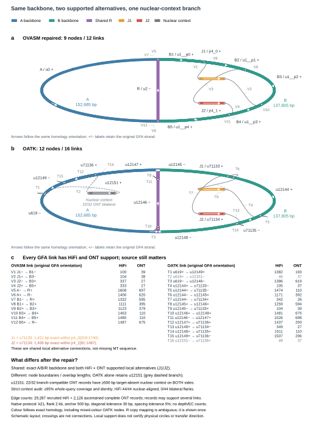

# OVASM mechanism figure


**Figure. Evidence-aware organelle assembly with OVASM.** Reads enter technology-specific graph construction: native closed-syncmer or portable graphs for HiFi, correction followed by graph construction for noisy long reads, and dense k-mer graphs for short reads. Seed recruitment or discovery supplies candidate organelle reads; the native multichrom HiFi strategy can construct the graph from the original whole-genome input. Read-supported flank pairings resolve repeats where evidence permits; ambiguous or partial walks remain alternatives. Native multichrom consensus pools observations at shared graph coordinates and counts each read position once. Component assessment combines marker and coverage evidence with optional original-read source contexts. Source-exclusive evidence can exclude eligible singleton cycles; compatible or unresolved components retain their evidence status. Export provides organelle sequences, graphs and evidence reports. Optional evaluation against a same-sample reference reports relaxed recovery and strict specificity, correspondence and length criteria.

Solid arrows show processing in numbered order (1 → 2 → 3 → 4 → 5 → 6). Dashed arrows show original-read evidence entering component assessment and optional evaluation after export (6 → 7). The schematic does not represent measured lengths, chromosome counts or demonstrated physical topology. Graph cycles and FASTA record counts do not establish physical molecule number or topology.

The figure describes the combined OVASM implementation. Technology selectors and evidence features depend on the execution strategy: the standalone public `run` command supports HiFi and short reads; the OrganelleVerse integration supplies the ONT/CLR adapter. Source review used public OVASM `b529d67` and OrganelleVerse integration `330ce767`. This is a mechanism diagram, not a benchmark result or a claim of independent biological validation.

## Files and reproduction

- [Editable SVG](ovasm-mechanism-v2.svg): the user-selected v2 artwork, preserved byte for byte.
- [Vector PDF](ovasm-mechanism-v2.pdf) and [600 dpi PNG](ovasm-mechanism-v2.png): matching exports.
- [Python source](draw_ovasm_mechanism_v2.py): Matplotlib source; requires Matplotlib and a compatible sans-serif font. Run `python draw_ovasm_mechanism_v2.py` to export into this directory. SVG metadata and font metrics may vary by environment.

Final dimensions are 183 × 124 mm. Server audits of the supplied PDF found a minimum text size of 5.2 pt, no text below 5 pt, and no detected text collisions or clipping. The layout is a continuous seven-step schematic rather than a quantitative multi-panel plot. The previous workflow artwork remains at `../workflow.svg`.

## ZM4 HiFi/ONT-supported GFA comparison



[SVG](OVASM-OATK-homology-matched.svg) · [PDF](OVASM-OATK-homology-matched.pdf) ·
[Source data](zm4-gfa-comparison-data.json) · [Homology coordinates](zm4-homology-correspondence.tsv) ·
[Read counts](zm4-link-read-support.tsv) · [Python source](draw_zm4_gfa_comparison.py)

Every original node and link is retained. Exact A/B/R homology governs the shared
layout, colours and displayed sequence direction; original GFA strands remain in
labels and the link table. OATK u71133 matches OVASM jr4_0[319:1740) exactly and
forward; u71134 matches jr4_1[81:1487). Boundary-crossing nodes use multiple homology
colours and retain every base. Layout is schematic, not bp-scaled; crossings are
not connections. Repeat-copy orthology is unresolved rather than arbitrarily assigned.

All 28 edge counts use the same native k21 / 2-kb flank / 500-bp anchor / 30-bp
diagonal / 5% spacing protocol on 29,287 complete recruited HiFi and 2,126 ascertained
complete ONT candidate records. Counts overlap across links and are not physical
configuration proportions. No assembler depth/EC/SC substitutes for read support.
The JSON retains graph hashes, formal source/binary provenance and prior independent
validation of all 28 overlaps and 20 non-nuclear-context nodes' exact sequence/direction.

The grey u12151 branch has strong nuclear context: 22/32 branch-compatible ONT
records meet >=95% whole-query coverage/identity and >=500-bp bilateral target-absent
nuclear flanks. HiFi 44/44 meet the nuclear-alignment rule, but 0/44 have qualifying
bilateral specific flanks. Other reads remain unresolved. Local edge support alone
certifies neither physical origin nor physical circles. The same-plant relation of
the HiFi/ONT materials is the user's material confirmation; no independent truth
score is assigned.

Reproduce the display from reviewed source data, without raw-read rescanning:

```sh
python docs/figures/draw_zm4_gfa_comparison.py --out /path/to/figure-output
```

Requires Matplotlib and NumPy. The script checks the complete graph inventory and
measures final comparable-panel rectangles. Optional
`--alignment-helper /path/to/audit_panel_alignment.py` adds publication QA.
SVG/PDF: 183 x 247 mm, editable text, minimum 6.1 pt, no detected text collisions
in the reviewed export. Font metrics can differ; inspect regenerated figures.
This script reproduces presentation, not new origin inference or assembly.
Native algorithm code remains in src/junctions.rs and src/read_context.rs.
